# Knowledge Base

**English** · [Türkçe](README.tr.md)

A knowledge base that answers a team's questions from the team's own documents, and shows where every answer comes from. Members upload Markdown, text and PDF files to a workspace. The files are split into passages and embedded in the background. A question searches those passages by meaning and by words at once, and a language model writes the answer with numbered citations. When the documents do not cover a question, the answer says so and no model is asked. Workspaces keep each team's documents, searches and conversations to its own members.

[](https://github.com/Beratoguzhan620/knowledge-base-api/actions/workflows/ci.yml)


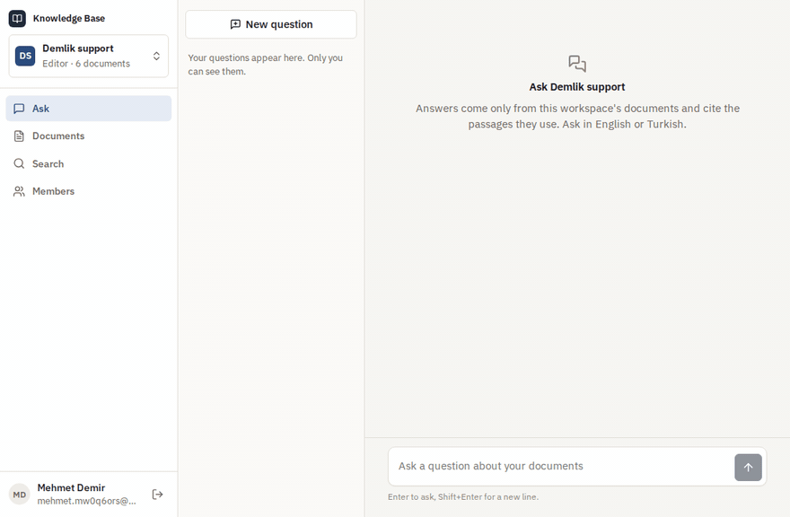

## Try it

```bash
docker compose up --build
```

This starts PostgreSQL with pgvector, Ollama, the API and nginx with the web app. The first start downloads two small models into a volume (nomic-embed-text and qwen2.5:1.5b, about 1.3 GB); later starts reuse them. Open http://localhost:8080, create an account, and drop the files from [`samples/`](samples) into *Documents*: a small coffee shop's returns policy, shipping rules, brewing guide, support handbook, a Turkish returns page and a PDF on equipment care. Then ask, for example, "How long does a refund take?" or "Para iadesi kaç günde yapılır?".

- Without downloading anything: `docker compose -f docker-compose.yml -f docker-compose.light.yml up --build` uses the built-in embedding and an extractive answerer that quotes the documents (this is what CI uses).
- Another model, or OpenAI: set `Embeddings__*` and `Chat__*` for the `api` service (any service with the OpenAI API shape works: Ollama, LM Studio, vLLM, OpenAI).
- API reference: http://localhost:8080/scalar

## Features

- **Workspaces and roles:** an account comes with a workspace; more can be created. Readers search and ask, editors also add and delete documents, owners also manage members and the workspace. Membership and role are read from the database on every request.
- **Documents:** Markdown, text and PDF up to 10 MB, 100 MB per workspace. Markdown is split at its headings and every passage remembers its heading path ("Returns › Refunds"); PDFs keep their page numbers. The same file twice in a workspace is refused, and so is a file that cannot be read, with the reason.
- **Background indexing:** a document is readable as soon as it is uploaded, and searchable when its passages are embedded. The list follows the status (waiting, indexing, ready, failed) live. Failures are retried with a growing pause, and a failed document can be queued again.
- **Hybrid search:** meaning (pgvector, HNSW, cosine) and words (PostgreSQL full-text search in English or Turkish) in one query, merged by reciprocal rank fusion. The search page shows where each passage ranked in each.
- **Answers with citations:** the answer streams in as it is written. Each fact carries the number of its passage, and the numbers are buttons that point at the quoted sources below. A question the documents do not cover is not answered, in the language of the question.
- **Conversations:** follow-up questions see the earlier turns. Conversations are private to the person asking, owners included. Answers can be rated, and keep their quotes even after a document is deleted.
- **Models of your choice:** the built-in embedding and extractive answerer, Ollama in Compose, or any OpenAI-compatible service, chosen by configuration. After a model change, owners queue the workspace for indexing again.
- **Web app:** React and TypeScript. Ask, documents with drag-and-drop upload, a document's passages, search, members, a workspace switcher; empty, loading and error states, and a phone layout.

## Screenshots

| An answer with its sources | A question the documents do not cover |
|---|---|
| 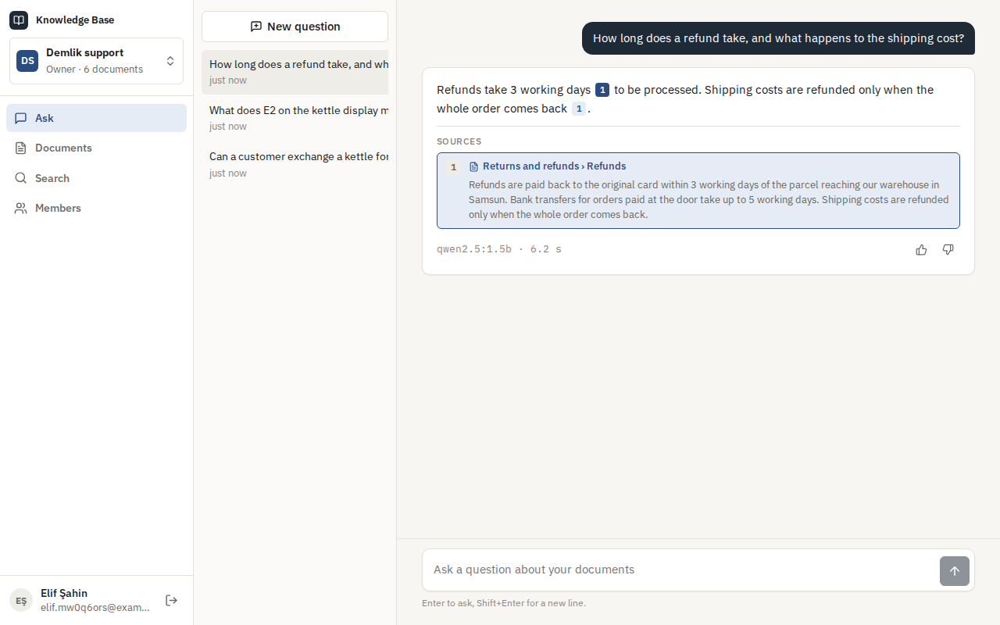 | 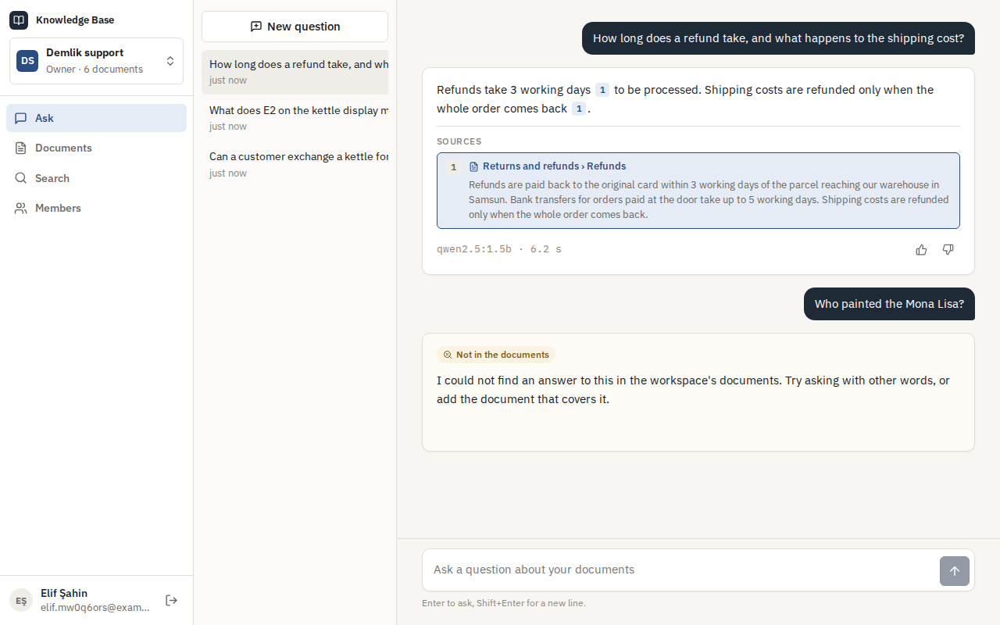 |
| **Asked in Turkish** | **Documents and indexing** |
| 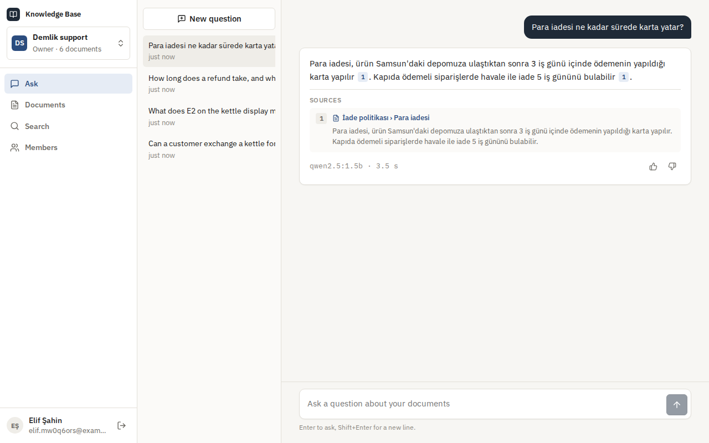 | 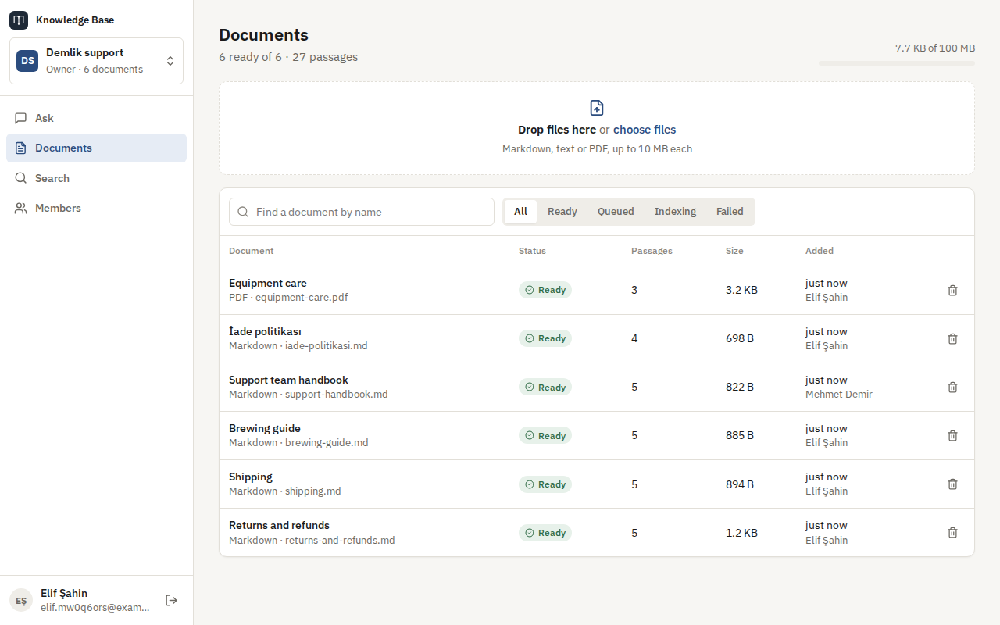 |
| **A document's passages** | **Search, ranked by meaning and by words** |
| 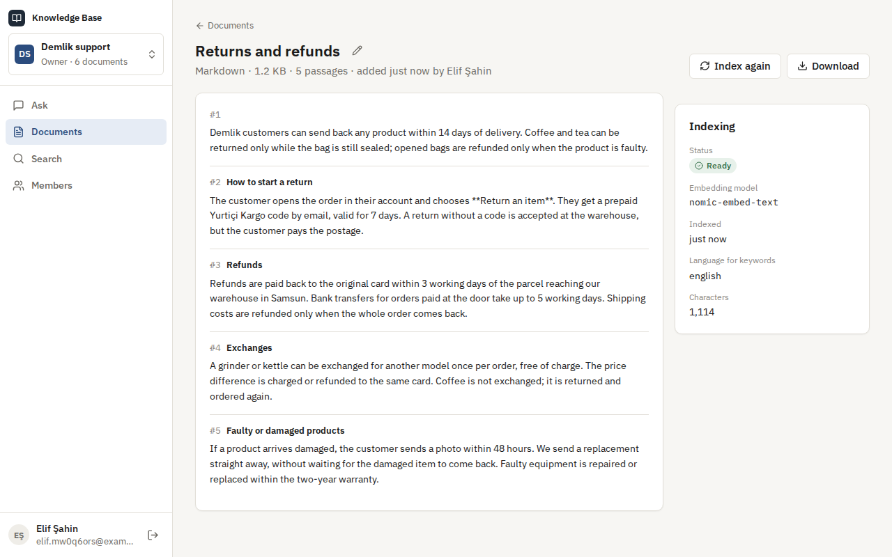 | 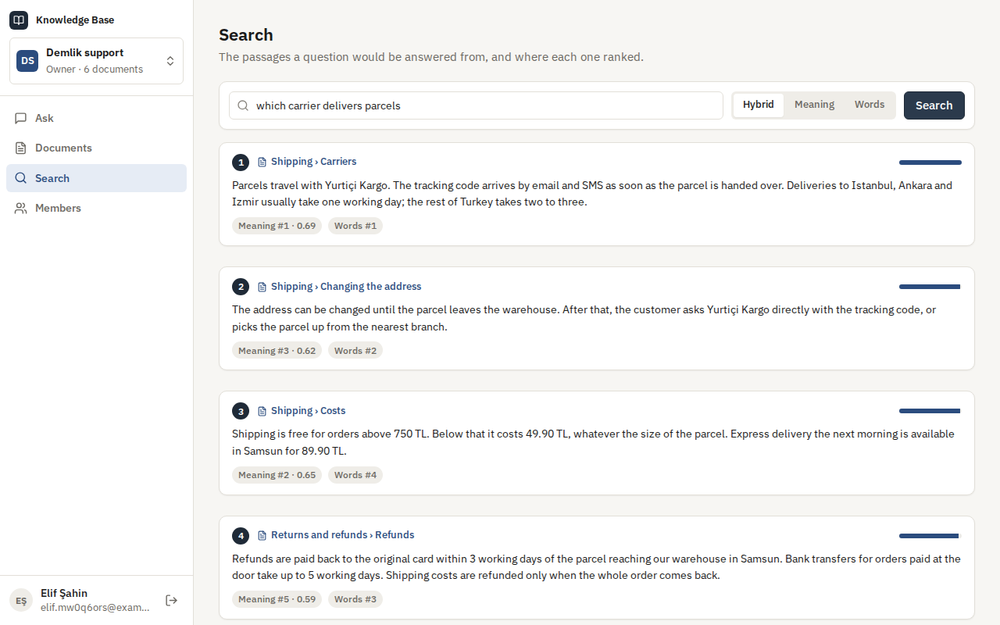 |
| **Members and roles** | **Sign in** |
| 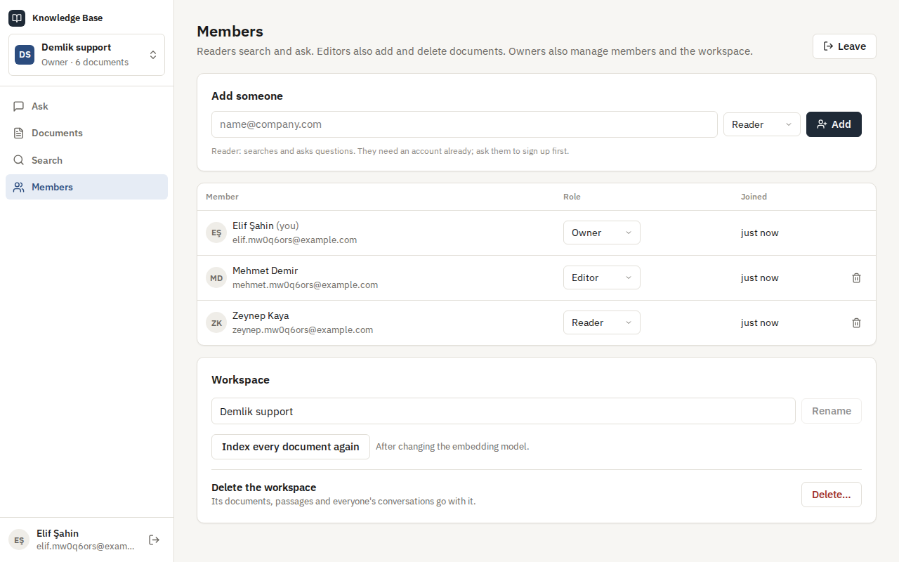 | 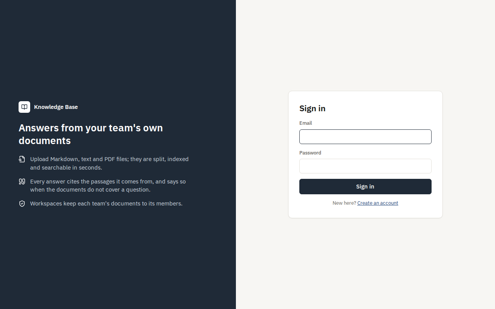 |
| **On a phone** | **API reference** |
| 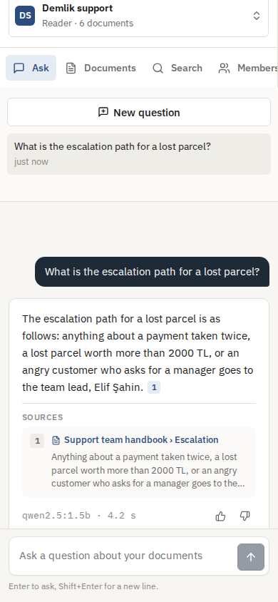 | 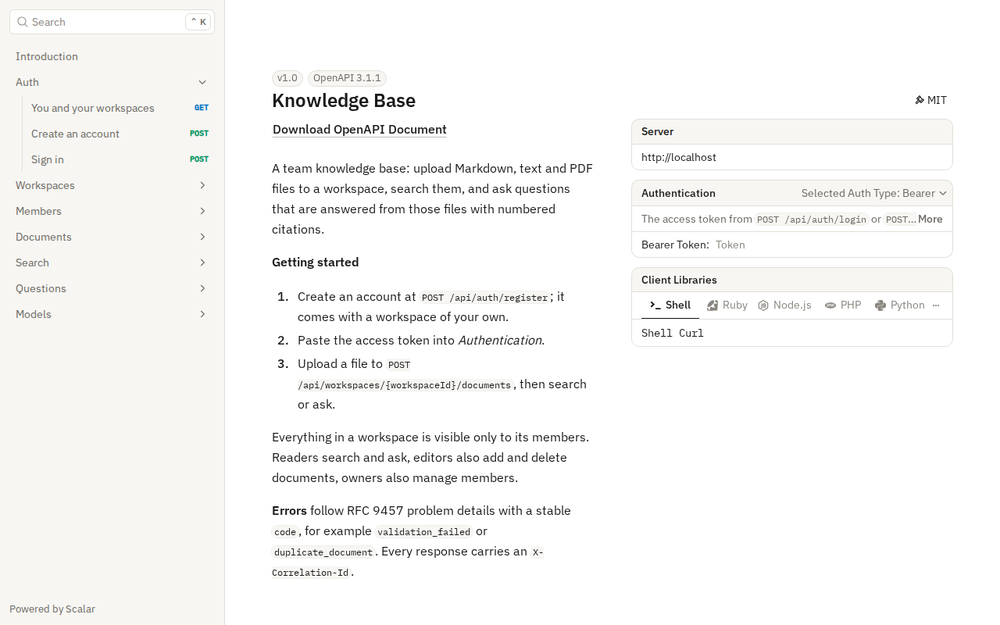 |

## Measured

**Retrieval and answers.** `tests/eval/run.mjs` uploads the sample documents and asks 32 questions whose source passage is known. Three of them are in Turkish and one is a bare product code. It also asks five questions the documents do not cover. Measured on a standard GitHub Actions runner, without a GPU.

| Models | Hybrid hit@1 | Hybrid hit@3 | MRR | Meaning only, hit@1 | Words only, hit@1 | Answers citing the right passage | Outside questions left unanswered | Answer time p50 / p95 |
|---|---|---|---|---|---|---|---|---|
| Built-in (hashing embedding, extractive answers) | 84% | 88% | 0.88 | 78% | 81% | 30 of 32 | 5 of 5 | under 0.1 s |
| nomic-embed-text and qwen2.5:1.5b through Ollama | 91% | 97% | 0.94 | 100% | 78% | 32 of 32 | 5 of 5 | 3.2 s / 11.5 s |

What the numbers say:

- With the built-in embedding, meaning and words together rank better than either alone.
- With nomic-embed-text, meaning alone put every right passage first on this small set. In hybrid, a few passages that share common words with the question took first place, but the right passage was always among the sources the model got, and every answer cited it.
- Words still decide for a bare product code like "KHV-002", which the embedding scores low (0.56).
- Indexing the six documents (27 passages) took 0.5 s with the built-in model and 3.6 s with nomic-embed-text on the runner's CPU.

**How the relevance threshold was set.** The same run prints how similar the right passage is to its question, and how similar the best passage is to a question outside the documents:

- Built-in model: right passages 0.02 to 0.55 (median 0.33); outside questions at most 0.16.
- nomic-embed-text: right passages 0.56 to 0.83 (median 0.76); outside questions at most 0.63, the highest being a Turkish question to an English-trained model.

The thresholds (0.18 and 0.64) sit in those gaps. A passage that holds half of the question's words also counts; no passage held more than 0.4 of an outside question's words. The thresholds were set on these same questions, so measure your own with `tests/eval` before relying on them.

**Many teams at once.** `tests/load/load.mjs` on the same kind of runner, against the light stack (built-in models, so it measures the system rather than a model), with the load client on the same machine:

| Measure | Result |
|---|---|
| 20 teams upload the 6 sample documents at the same moment (120 files) | upload answered in p50 114 ms, p95 282 ms (reading and splitting; embedding comes after) |
| Background indexing, two workers | all 540 passages searchable 1.1 s after the first upload, about 490 per second |
| Hybrid search, 32 at a time | 800 searches, p50 76 ms, p95 130 ms |
| Questions answered, 32 at a time | 200 questions, p50 91 ms, p95 145 ms |
| Isolation | every hit and every citation came from the asking team's own documents |

## Tech stack

- ASP.NET Core 10: minimal APIs, server-sent events, ProblemDetails, OpenAPI with Scalar, JWT bearer, rate limiting, a background service
- PostgreSQL 17 with pgvector (HNSW, cosine distance, iterative index scans) and full-text search (English and Turkish stemming); Entity Framework Core 10 and Npgsql
- Ollama with nomic-embed-text and qwen2.5:1.5b, or any OpenAI-compatible API; Microsoft.Extensions.Http.Resilience
- PdfPig for PDF text
- React 18, TypeScript and Vite; Lucide icons and IBM Plex; nginx
- xUnit, Testcontainers (PostgreSQL with pgvector), Vitest, Playwright
- GitHub Actions: warnings as errors, .NET and web tests, pending-migration check, Compose smoke test, browser walkthrough, a job with the real models
- Docker / Docker Compose

## Architecture

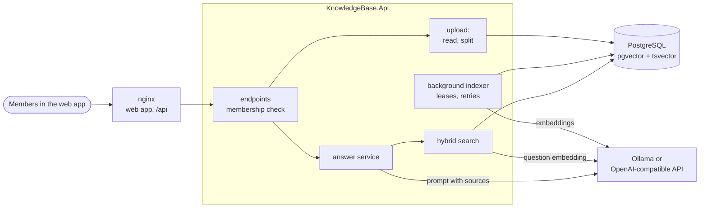

From a question to a cited answer:

```mermaid
sequenceDiagram
    participant B as Browser
    participant A as API
    participant P as PostgreSQL
    participant M as Model
    B->>A: POST …/messages (Accept: text/event-stream)
    A->>A: member of this workspace?
    A->>M: embed the question
    A->>P: nearest passages ∪ full-text matches, in this workspace (one SQL statement)
    A->>A: fuse ranks; keep what is close enough
    alt nothing relevant
        A-->>B: "not in the documents" (no model call)
    else passages found
        A-->>B: event: sources [1] [2] [3]
        A->>M: instructions + numbered, fenced passages + earlier turns
        M-->>A: tokens
        A-->>B: event: delta … (as written)
        A->>P: store question, answer and the cited passages
        A-->>B: event: done
    end
```

## Design decisions

- **One database for documents and vectors.** PostgreSQL with pgvector keeps passages, embeddings, permissions and conversations together. Deleting a document removes its vectors in the same transaction, and every search is filtered by workspace in the same statement that ranks it. There is no second store to keep in step.
- **Hybrid search with reciprocal rank fusion.** Embeddings find passages that mean the same thing in other words; full-text search finds exact words such as product codes and names, which embeddings blur. Both run in one SQL statement and are merged by rank (`1 / (60 + rank)`), so no score needs calibrating against another. Full-text search uses the stemming of each document's language, guessed when it is uploaded, so "iadeleri" finds "iadesi".
- **Any word, not every word.** The question's words are combined with OR, and passages with more of them, closer together, rank higher. A question is worded differently from its answer, so requiring every word would miss most answers.
- **Passages that know where they are.** Markdown is split at headings and the heading path is kept with each passage and embedded with it, so "Refunds" under "Returns" means what it should. Passages follow paragraphs, then sentences, never cross a heading or a page, and overlap by one sentence.
- **No answer is better than an invented one.** Only passages close enough in meaning, or holding at least half of the question's words, go to the model. The similarity threshold depends on the embedding model, so it was measured for each one (see *Measured*). At first any shared word counted, and four of five questions outside the documents got an answer. If no passage qualifies, the answer says the documents do not cover the question, and the model is never asked.
- **Citations the server can check.** The model sees the passages numbered and must cite them like `[1]`. Only cited passages are stored with the answer, with their quote, so an answer stays readable after its document is deleted. Small local models sometimes forget the markers. Then the server attributes each sentence to the passage it shares the most content words with, so the answer can still be traced.
- **Documents are data, not instructions.** Passages are fenced off in the prompt and their fence markers are neutralised, so a document cannot close its fence. The instructions say to ignore anything inside a source that gives orders. Answers and documents are rendered as text in the web app, under a strict content security policy.
- **Indexing in the background, safely in parallel.** Workers claim a document with `FOR UPDATE SKIP LOCKED` and hold it on a lease. Two workers never take the same document, and one that dies leaves its document to another when the lease runs out. A failed attempt is retried after 10 s, 20 s, 40 s… and reported after the last one. The upload request only reads and splits the file, so it answers at once.
- **Models behind one interface.** Embeddings and answers each have a built-in implementation and an OpenAI-compatible one. The built-in ones (hashed words and word pieces; quoted sentences) need no download. Tests, CI and the light stack run fully offline with them, and the real models are exercised in a separate CI job. Every document records the embedding model it was indexed with; search only compares vectors from the current model, and owners can queue the workspace again after a change.
- **Streaming as server-sent events.** Sources arrive first, then the text as the model writes it, then the stored answer. nginx passes the stream on unbuffered. Without `Accept: text/event-stream` the same endpoint returns the whole answer as JSON.
- **Privacy inside a team.** Workspace membership is checked on every request; another workspace's documents, searches and conversations do not exist for an outsider. Conversations belong to the person who asks, so an owner sees the team's documents, not its questions.

## Commands

| Command | What it does |
|---|---|
| `docker compose up --build` | The whole app with Ollama on http://localhost:8080 |
| `docker compose -f docker-compose.yml -f docker-compose.light.yml up --build` | The same with the built-in models, no download |
| `dotnet test` | .NET unit and integration tests (Docker needed for Testcontainers) |
| `cd web && npm install && npm test` | Web app unit tests |
| `cd web && npm run dev` | The web app with hot reload on http://localhost:5173, against an API on port 8080 |
| `bash tests/smoke/ask.sh` | Upload, wait for indexing, search and ask against a running stack |
| `cd tests/e2e && npm install && node kb.mjs` | The browser walkthrough against a stack started with `AUTH_ATTEMPTS_PER_MINUTE=1000` |
| `node tests/eval/run.mjs` | The retrieval and answer measurements against a stack started with `QUESTIONS_PER_MINUTE=1000` |
| `node tests/load/load.mjs 20 40 32` | The many-teams test against a stack started with `AUTH_ATTEMPTS_PER_MINUTE=100000 QUESTIONS_PER_MINUTE=100000` |
| `dotnet ef migrations add <Name> --project src/KnowledgeBase.Infrastructure --startup-project src/KnowledgeBase.Api --output-dir Persistence/Migrations` | Add a migration |

Configuration for a local run, kept out of the repository:

```bash
dotnet user-secrets --project src/KnowledgeBase.Api set "ConnectionStrings:KnowledgeBase" "Host=localhost;Database=knowledge_base;Username=…;Password=…"
dotnet user-secrets --project src/KnowledgeBase.Api set "Jwt:SigningKey" "<at least 32 characters>"
# Optional: real models
dotnet user-secrets --project src/KnowledgeBase.Api set "Embeddings:Provider" "OpenAI"
dotnet user-secrets --project src/KnowledgeBase.Api set "Embeddings:BaseUrl" "http://localhost:11434/v1/"
dotnet user-secrets --project src/KnowledgeBase.Api set "Chat:Provider" "OpenAI"
dotnet user-secrets --project src/KnowledgeBase.Api set "Chat:BaseUrl" "http://localhost:11434/v1/"
```

## Tests

107 tests and four runs against the whole stack: 54 .NET unit tests, 45 integration tests that run the real API against PostgreSQL with pgvector in Testcontainers, 8 Vitest tests for the web app, a 12-step Playwright walkthrough, and a smoke test with the light models and again with the real ones, all in CI.

- **Reading and splitting:** Markdown headings and their paths, code blocks, front matter, line endings; paragraphs, sentences and overlap; very long words; UTF-8, byte order marks and UTF-16, other encodings and binary data refused; PDFs page by page; damaged PDFs; language detection.
- **Workspaces:** registration with a first workspace, roles from reader to owner, readers kept from uploading, a removed or demoted member losing access on the next request, the last owner kept, two owners demoting each other at the same moment, deleting a workspace with everything in it.
- **Documents:** upload, title from the first heading, duplicates, unreadable files, the size and storage limits, listing, filtering and renaming, download as an attachment, and another workspace's documents not existing for outsiders.
- **Indexing:** every passage embedded, workers at the same time never taking the same document, a failing model retried and then reported, a document left by a dead worker taken over after its lease, and reindexing after a model change.
- **Search:** the right passage first for a paraphrased question, product codes found by words, ranks by meaning, documents not yet indexed left out, Turkish stemming, and no result ever from another workspace.
- **Answers:** citations pointing at the right passage, the not-found path without a model call in English and Turkish, an unrelated question after an answered one, earlier turns given to the model, streaming in order, a model failing half-way, private conversations, citations kept after a document is deleted, rating, and the per-person limit.
- **Web app (Vitest):** citation markers, server-sent events arriving in pieces, routes, sizes and times.
- **Browsers (CI):** sign-up, uploads with a refused file and a duplicate, indexing until ready, passages and PDF pages, search ranks, a cited answer, a question outside the documents, rating, a reader added and then removed, the phone layout, and no script errors.

## Roadmap and known gaps

- More formats: Word documents and web pages.
- Re-ranking the fused passages with a cross-encoder before they go to the model.
- Sharing a conversation with the rest of the workspace.
- Invitations by email for people without an account, through the [notification-service](https://github.com/Beratoguzhan620/notification-service).
- Scanned PDFs need text recognition; today they are refused as having no text.
- The rate limits live in the API's memory; with several instances they would move to Redis.

## License

[MIT](LICENSE) · Berat Oğuzhan Turğut · [GitHub](https://github.com/Beratoguzhan620)
