# Knowledge Base

[English](README.md) · **Türkçe**

Bir ekibin sorularını ekibin kendi belgelerinden cevaplayan ve her cevabın nereden geldiğini gösteren bir bilgi bankası. Üyeler bir çalışma alanına Markdown, metin ve PDF dosyaları yükler. Dosyalar pasajlara bölünür ve arka planda vektöre çevrilir. Bir soru, bu pasajlarda anlama ve kelimelere göre aynı anda arama yapar; bir dil modeli de cevabı numaralı kaynaklarla yazar. Belgeler bir soruyu karşılamıyorsa cevap bunu söyler ve modele hiç sorulmaz. Çalışma alanları her ekibin belgelerini, aramalarını ve konuşmalarını yalnızca kendi üyelerine açar.

[](https://github.com/Beratoguzhan620/knowledge-base-api/actions/workflows/ci.yml)


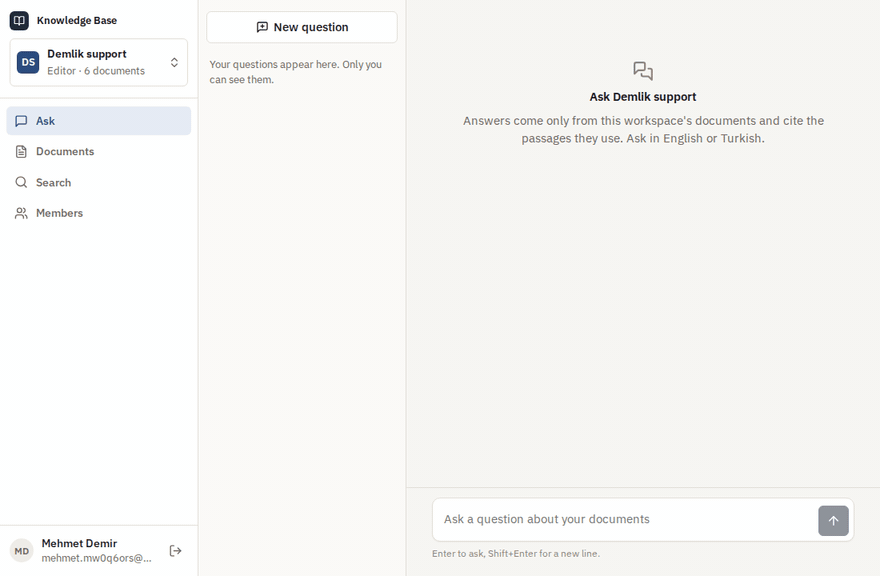

## Deneyin

```bash
docker compose up --build
```

Bu komut pgvector'lü PostgreSQL'i, Ollama'yı, API'yi ve web uygulamasıyla nginx'i başlatır. İlk açılışta iki küçük model bir volume'a indirilir (nomic-embed-text ve qwen2.5:1.5b, yaklaşık 1,3 GB); sonraki açılışlar bunları yeniden kullanır. http://localhost:8080 adresini açın, hesap oluşturun ve [`samples/`](samples) klasöründeki dosyaları *Documents* sayfasına bırakın: küçük bir kahve dükkânının iade politikası, kargo kuralları, demleme rehberi, destek el kitabı, Türkçe bir iade sayfası ve ekipman bakımı üzerine bir PDF. Sonra örneğin "How long does a refund take?" ya da "Para iadesi kaç günde yapılır?" diye sorun.

- Hiçbir şey indirmeden: `docker compose -f docker-compose.yml -f docker-compose.light.yml up --build` yerleşik embedding'i ve belgelerden alıntı yapan ayıklayıcı cevaplayıcıyı kullanır (CI bunu kullanır).
- Başka bir model ya da OpenAI: `api` servisi için `Embeddings__*` ve `Chat__*` ayarlarını verin (OpenAI API biçimini konuşan her servis olur: Ollama, LM Studio, vLLM, OpenAI).
- API dokümanı: http://localhost:8080/scalar

## Özellikler

- **Çalışma alanları ve roller:** her hesap bir çalışma alanıyla gelir; yenileri oluşturulabilir. Okuyucular arar ve sorar, editörler ayrıca belge ekler ve siler, sahipler ayrıca üyeleri ve çalışma alanını yönetir. Üyelik ve rol her istekte veritabanından okunur.
- **Belgeler:** 10 MB'a kadar Markdown, metin ve PDF; çalışma alanı başına 100 MB. Markdown başlıklarından bölünür ve her pasaj başlık yolunu hatırlar ("Returns › Refunds"); PDF'ler sayfa numaralarını korur. Aynı dosyanın bir çalışma alanına ikinci kez eklenmesi de okunamayan bir dosya da nedeni söylenerek reddedilir.
- **Arka planda indeksleme:** belge yüklenir yüklenmez okunabilir, pasajları vektöre çevrildiğinde de aranabilir olur. Liste durumu (bekliyor, indeksleniyor, hazır, başarısız) canlı izler. Hatalar artan aralıklarla yeniden denenir, başarısız bir belge yeniden sıraya alınabilir.
- **Hibrit arama:** anlam (pgvector, HNSW, kosinüs) ve kelimeler (İngilizce ya da Türkçe PostgreSQL tam metin araması) tek sorguda; reciprocal rank fusion ile birleştirilir. Arama sayfası her pasajın her iki aramada kaçıncı geldiğini gösterir.
- **Kaynaklı cevaplar:** cevap yazıldıkça akarak gelir. Her bilgi kendi pasajının numarasını taşır; numaralar aşağıdaki alıntılara giden düğmelerdir. Belgelerin karşılamadığı bir soru, sorunun dilinde, cevapsız bırakıldığı söylenerek kapatılır.
- **Konuşmalar:** devam soruları önceki turları görür. Konuşmalar soranındır, sahipler dahil kimse göremez. Cevaplar değerlendirilebilir ve belge silinse bile alıntılarını korur.
- **İstediğiniz modeller:** yerleşik embedding ve ayıklayıcı cevaplayıcı, Compose'daki Ollama ya da OpenAI uyumlu herhangi bir servis; ayarla seçilir. Model değişince sahipler çalışma alanını yeniden indekslemeye alır.
- **Web uygulaması:** React ve TypeScript. Soru-cevap, sürükle-bırak yüklemeli belgeler, bir belgenin pasajları, arama, üyeler, çalışma alanı değiştirici; boş, yükleniyor ve hata durumları ve telefon görünümü.

## Ekran görüntüleri

| Kaynaklarıyla bir cevap | Belgelerin karşılamadığı bir soru |
|---|---|
| 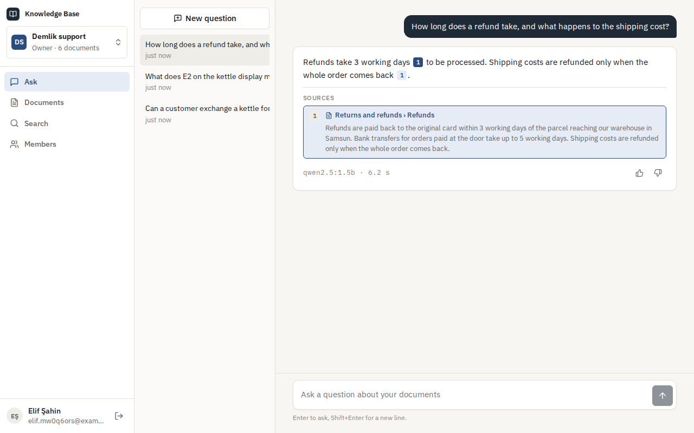 | 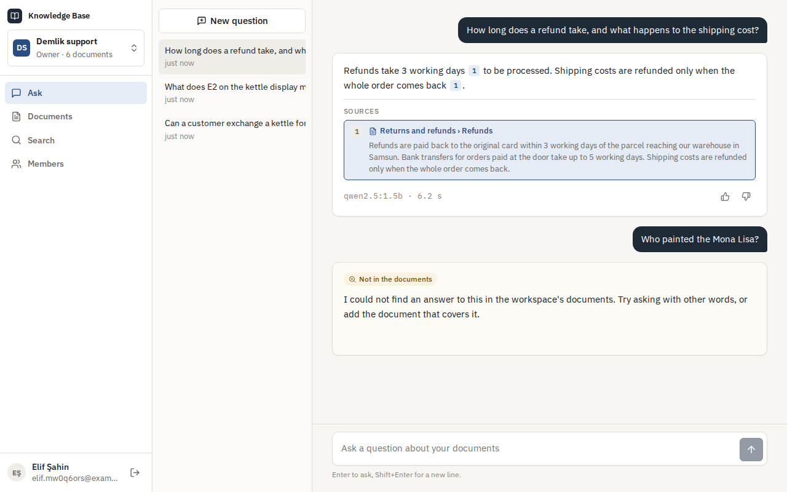 |
| **Türkçe sorulan soru** | **Belgeler ve indeksleme** |
| 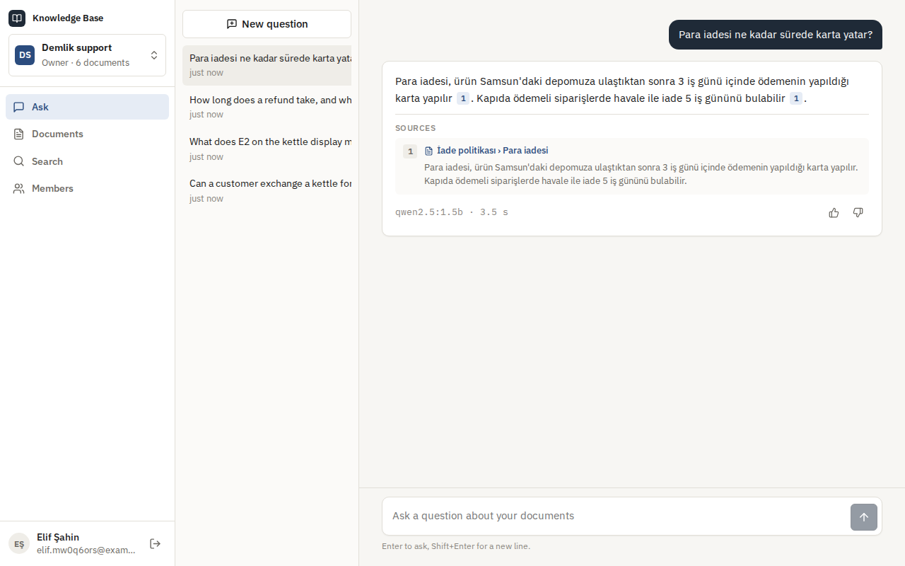 | 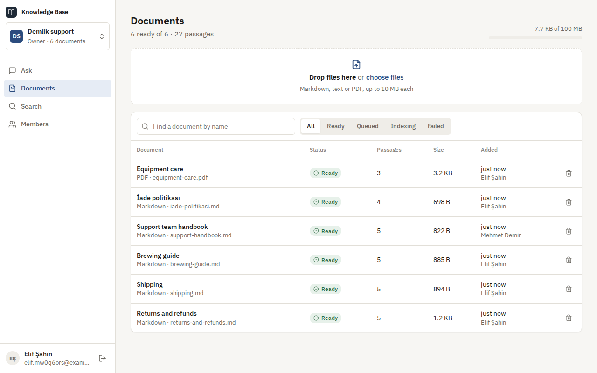 |
| **Bir belgenin pasajları** | **Anlam ve kelimelere göre sıralanmış arama** |
| 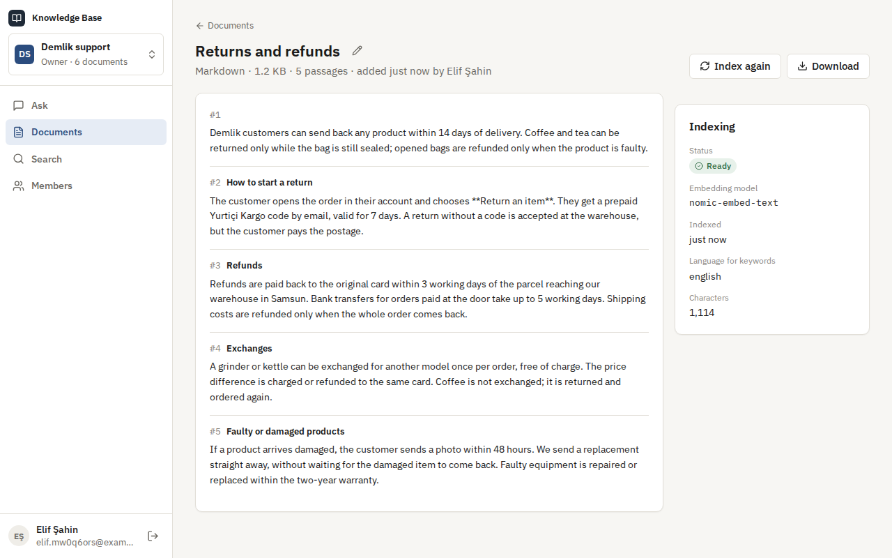 | 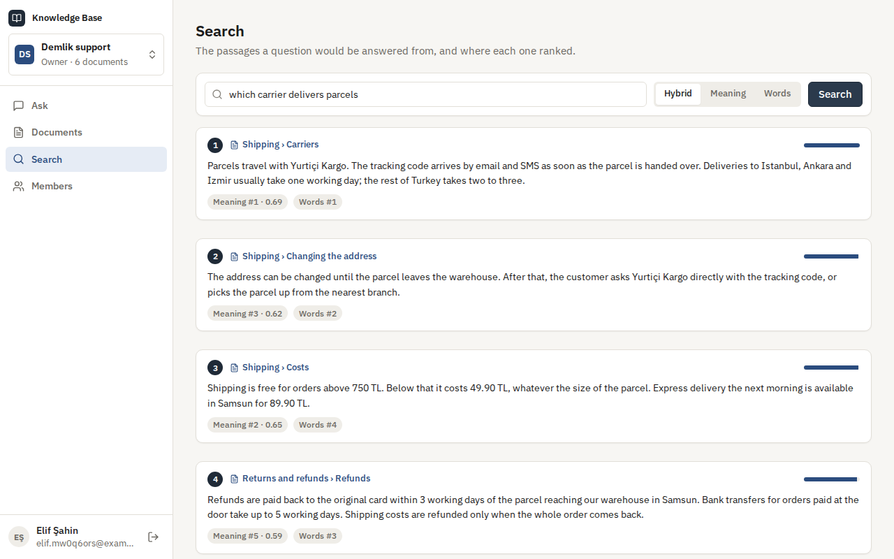 |
| **Üyeler ve roller** | **Giriş** |
| 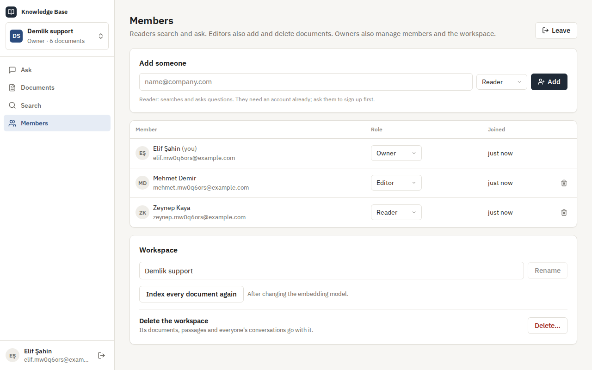 | 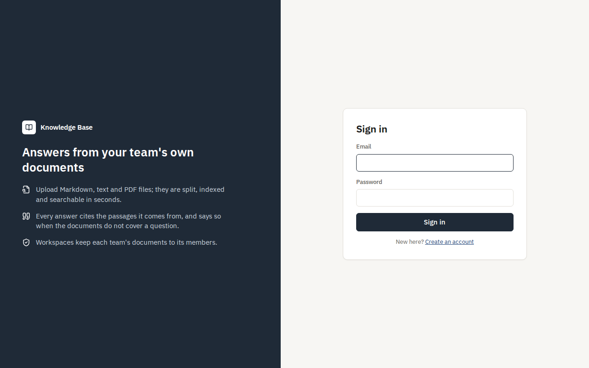 |
| **Telefonda** | **API dokümanı** |
| 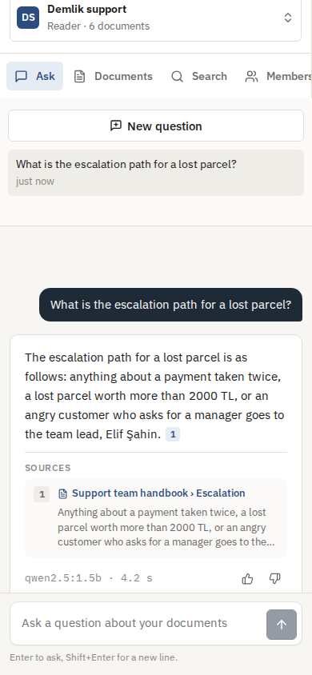 | 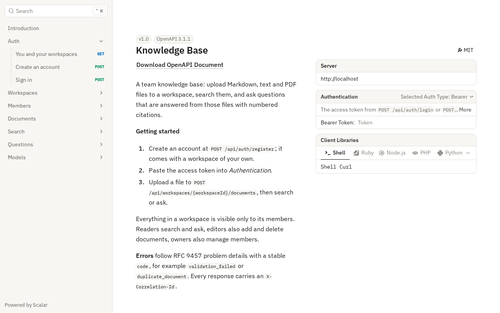 |

## Ölçümler

**Arama ve cevaplar.** `tests/eval/run.mjs` örnek belgeleri yükler ve kaynak pasajı bilinen 32 soru sorar. Bunların üçü Türkçedir, biri de yalnızca bir ürün kodudur. Belgelerin karşılamadığı beş soru da sorar. Standart bir GitHub Actions sunucusunda, GPU olmadan ölçüldü.

| Modeller | Hibrit hit@1 | Hibrit hit@3 | MRR | Yalnız anlam, hit@1 | Yalnız kelime, hit@1 | Doğru pasaja atıf yapan cevaplar | Cevapsız bırakılan dış sorular | Cevap süresi p50 / p95 |
|---|---|---|---|---|---|---|---|---|
| Yerleşik (özetleme embedding'i, ayıklayıcı cevaplar) | %84 | %88 | 0,88 | %78 | %81 | 32'de 30 | 5'te 5 | 0,1 sn'nin altında |
| Ollama üzerinden nomic-embed-text ve qwen2.5:1.5b | %91 | %97 | 0,94 | %100 | %78 | 32'de 32 | 5'te 5 | 3,2 sn / 11,5 sn |

Rakamların söyledikleri:

- Yerleşik embedding'le anlam ve kelimeler birlikte, ikisinden de tek başına daha iyi sıralıyor.
- nomic-embed-text'le bu küçük sette yalnız anlam her doğru pasajı ilk sıraya koydu. Hibritte soruyla sık kullanılan kelimeleri paylaşan birkaç pasaj ilk sırayı aldı; ama doğru pasaj her seferinde modele giden kaynaklar arasındaydı ve her cevap ona atıf yaptı.
- Embedding'in düşük puan verdiği (0,56) "KHV-002" gibi yalnız bir ürün kodunda karar yine kelimelerde.
- Altı belgenin (27 pasaj) indekslenmesi, sunucunun CPU'sunda yerleşik modelle 0,5 sn, nomic-embed-text'le 3,6 sn sürdü.

**İlgililik eşiği nasıl belirlendi.** Aynı çalıştırma, doğru pasajın sorusuna ne kadar benzediğini ve belgelerin dışındaki bir soruya en çok benzeyen pasajın ne kadar benzediğini yazdırır:

- Yerleşik model: doğru pasajlar 0,02 ile 0,55 arası (ortanca 0,33); dış sorular en çok 0,16.
- nomic-embed-text: doğru pasajlar 0,56 ile 0,83 arası (ortanca 0,76); dış sorular en çok 0,63. En yükseği, İngilizce eğitilmiş bir modele sorulan Türkçe bir soru.

Eşikler (0,18 ve 0,64) bu aralıklara konuldu. Sorunun kelimelerinin yarısını içeren bir pasaj da sayılır; hiçbir pasaj bir dış sorunun kelimelerinin 0,4'ünden fazlasını içermedi. Eşikler bu sorularla belirlendi; onlara güvenmeden önce kendi sorularınızı `tests/eval` ile ölçün.

**Aynı anda çok sayıda ekip.** `tests/load/load.mjs`, aynı tür bir sunucuda, hafif yığına karşı (yerleşik modellerle; böylece modeli değil sistemi ölçer), yük istemcisi aynı makinedeyken:

| Ölçü | Sonuç |
|---|---|
| 20 ekip 6 örnek belgeyi aynı anda yüklüyor (120 dosya) | yükleme p50 114 ms, p95 282 ms'de cevaplandı (okuma ve bölme; embedding sonra gelir) |
| Arka planda indeksleme, iki işçi | 540 pasajın hepsi ilk yüklemeden 1,1 sn sonra aranabilir; saniyede yaklaşık 490 |
| Hibrit arama, aynı anda 32 | 800 arama, p50 76 ms, p95 130 ms |
| Cevaplanan sorular, aynı anda 32 | 200 soru, p50 91 ms, p95 145 ms |
| Yalıtım | her sonuç ve her atıf soran ekibin kendi belgelerinden geldi |

## Teknolojiler

- ASP.NET Core 10: minimal API'ler, server-sent events, ProblemDetails, Scalar ile OpenAPI, JWT bearer, hız sınırlama, arka plan servisi
- pgvector (HNSW, kosinüs uzaklığı, yinelemeli indeks taraması) ve tam metin aramasıyla (İngilizce ve Türkçe kök bulma) PostgreSQL 17; Entity Framework Core 10 ve Npgsql
- nomic-embed-text ve qwen2.5:1.5b ile Ollama ya da OpenAI uyumlu herhangi bir API; Microsoft.Extensions.Http.Resilience
- PDF metni için PdfPig
- React 18, TypeScript ve Vite; Lucide ikonları ve IBM Plex; nginx
- xUnit, Testcontainers (pgvector'lü PostgreSQL), Vitest, Playwright
- GitHub Actions: uyarılar hata sayılır, .NET ve web testleri, bekleyen migration kontrolü, Compose duman testi, tarayıcı senaryosu, gerçek modellerle bir iş
- Docker / Docker Compose

## Mimari

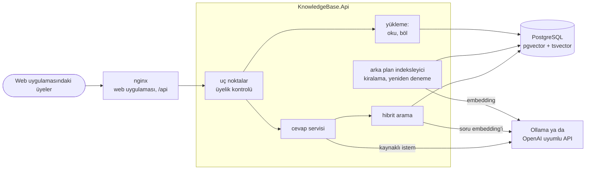

Sorudan kaynaklı cevaba:

```mermaid
sequenceDiagram
    participant B as Tarayıcı
    participant A as API
    participant P as PostgreSQL
    participant M as Model
    B->>A: POST …/messages (Accept: text/event-stream)
    A->>A: bu çalışma alanının üyesi mi?
    A->>M: soruyu vektöre çevir
    A->>P: en yakın pasajlar ∪ tam metin eşleşmeleri, bu çalışma alanında (tek SQL)
    A->>A: sıraları birleştir; yeterince yakın olanları tut
    alt ilgili bir şey yok
        A-->>B: "belgelerde yok" (model çağrısı yok)
    else pasajlar bulundu
        A-->>B: event: sources [1] [2] [3]
        A->>M: talimatlar + numaralı, çitlenmiş pasajlar + önceki turlar
        M-->>A: token'lar
        A-->>B: event: delta … (yazıldıkça)
        A->>P: soruyu, cevabı ve atıf yapılan pasajları kaydet
        A-->>B: event: done
    end
```

## Tasarım kararları

- **Belgeler ve vektörler için tek veritabanı.** pgvector'lü PostgreSQL pasajları, embedding'leri, yetkileri ve konuşmaları bir arada tutar. Bir belge silinince vektörleri aynı işlemde gider; her arama, sıralamayı yapan aynı SQL içinde çalışma alanına göre süzülür. Senkron tutulacak ikinci bir depo yok.
- **Reciprocal rank fusion ile hibrit arama.** Embedding'ler aynı şeyi başka kelimelerle anlatan pasajları bulur; tam metin araması da embedding'lerin bulanıklaştırdığı ürün kodları ve isimler gibi tam kelimeleri bulur. İkisi tek SQL ifadesinde çalışır ve sıraya göre (`1 / (60 + sıra)`) birleşir; hiçbir puanın diğerine göre ayarlanması gerekmez. Tam metin araması, yüklenirken tahmin edilen belge dilinin kök bulmasını kullanır; "iadeleri" araması "iadesi"ni bulur.
- **Her kelime değil, herhangi bir kelime.** Sorunun kelimeleri VEYA ile birleşir; daha çok kelimeyi, birbirine daha yakın içeren pasajlar öne çıkar. Soru cevabından farklı kelimelerle sorulur; her kelimeyi şart koşmak cevapların çoğunu kaçırırdı.
- **Yerini bilen pasajlar.** Markdown başlıklarından bölünür; başlık yolu her pasajla birlikte saklanır ve embedding'ine katılır, böylece "Returns" altındaki "Refunds" doğru anlamını taşır. Pasajlar paragrafları, sonra cümleleri izler, hiçbir zaman bir başlığı ya da sayfayı aşmaz ve birer cümle örtüşür.
- **Uydurma cevaptan cevapsızlık iyidir.** Modele yalnızca anlamca yeterince yakın ya da sorunun kelimelerinin en az yarısını içeren pasajlar gider. Benzerlik eşiği embedding modeline bağlıdır; bu yüzden her model için ölçüldü (bkz. *Ölçümler*). Başta tek bir ortak kelime yetiyordu ve belgelerin dışındaki beş sorudan dördü cevaplanıyordu. Hiçbir pasaj uygun değilse cevap, belgelerin soruyu karşılamadığını söyler ve modele hiç sorulmaz.
- **Sunucunun denetleyebildiği atıflar.** Model pasajları numaralı görür ve onlara `[1]` gibi atıf yapmak zorundadır. Cevapla birlikte yalnızca atıf yapılan pasajlar alıntılarıyla saklanır; belgesi silinse de cevap okunabilir kalır. Küçük yerel modeller bazen işaretleri unutur. O zaman sunucu her cümleyi en çok içerik kelimesini paylaştığı pasaja bağlar; cevap yine de izlenebilir.
- **Belgeler talimat değil, veridir.** Pasajlar istemde çitlenir ve çit işaretleri etkisizleştirilir; bir belge kendi çitini kapatamaz. Talimatlar, bir kaynağın içindeki emirleri yok saymayı söyler. Web uygulamasında cevaplar ve belgeler sıkı bir içerik güvenliği politikası altında metin olarak gösterilir.
- **Arka planda, paralelde güvenle indeksleme.** İşçiler bir belgeyi `FOR UPDATE SKIP LOCKED` ile alır ve bir kira süresiyle tutar. İki işçi aynı belgeyi hiçbir zaman almaz; ölen bir işçinin belgesi kira dolunca başkasına geçer. Başarısız bir deneme 10 sn, 20 sn, 40 sn… sonra yeniden denenir ve son denemeden sonra raporlanır. Yükleme isteği yalnızca dosyayı okur ve böler; hemen cevap verir.
- **Tek arayüzün arkasında modeller.** Embedding ve cevap için birer yerleşik, birer de OpenAI uyumlu uygulama var. Yerleşik olanlar (kelimelerin ve kelime parçalarının özetlenmesi; alıntılanan cümleler) indirme gerektirmez. Testler, CI ve hafif yığın onlarla tamamen çevrimdışı çalışır; gerçek modeller ayrı bir CI işinde sınanır. Her belge indekslendiği embedding modelini kaydeder; arama yalnızca güncel modelin vektörlerini karşılaştırır ve sahipler model değişince çalışma alanını yeniden sıraya alabilir.
- **Server-sent events ile akış.** Önce kaynaklar, sonra model yazdıkça metin, en sonda kaydedilen cevap gelir. nginx akışı tamponlamadan iletir. `Accept: text/event-stream` olmadan aynı uç nokta cevabın tamamını JSON olarak döner.
- **Ekip içinde gizlilik.** Çalışma alanı üyeliği her istekte denetlenir; başka bir çalışma alanının belgeleri, aramaları ve konuşmaları dışarıdan biri için yoktur. Konuşmalar soranındır; bir sahip ekibin belgelerini görür, sorularını değil.

## Komutlar

| Komut | Ne yapar |
|---|---|
| `docker compose up --build` | Ollama ile uygulamanın tamamı http://localhost:8080 adresinde |
| `docker compose -f docker-compose.yml -f docker-compose.light.yml up --build` | Aynısı yerleşik modellerle, indirme yok |
| `dotnet test` | .NET birim ve entegrasyon testleri (Testcontainers için Docker gerekir) |
| `cd web && npm install && npm test` | Web uygulamasının birim testleri |
| `cd web && npm run dev` | 8080 portundaki API'ye bağlı, anında yenilenen uygulama http://localhost:5173 adresinde |
| `bash tests/smoke/ask.sh` | Çalışan yığına karşı yükle, indekslenmesini bekle, ara ve sor |
| `cd tests/e2e && npm install && node kb.mjs` | `AUTH_ATTEMPTS_PER_MINUTE=1000` ile başlatılmış yığına karşı tarayıcı senaryosu |
| `node tests/eval/run.mjs` | `QUESTIONS_PER_MINUTE=1000` ile başlatılmış yığına karşı arama ve cevap ölçümleri |
| `node tests/load/load.mjs 20 40 32` | `AUTH_ATTEMPTS_PER_MINUTE=100000 QUESTIONS_PER_MINUTE=100000` ile başlatılmış yığına karşı çok ekipli test |
| `dotnet ef migrations add <Ad> --project src/KnowledgeBase.Infrastructure --startup-project src/KnowledgeBase.Api --output-dir Persistence/Migrations` | Migration ekler |

Depo dışında tutulan, yerel çalıştırma ayarları:

```bash
dotnet user-secrets --project src/KnowledgeBase.Api set "ConnectionStrings:KnowledgeBase" "Host=localhost;Database=knowledge_base;Username=…;Password=…"
dotnet user-secrets --project src/KnowledgeBase.Api set "Jwt:SigningKey" "<en az 32 karakter>"
# İsteğe bağlı: gerçek modeller
dotnet user-secrets --project src/KnowledgeBase.Api set "Embeddings:Provider" "OpenAI"
dotnet user-secrets --project src/KnowledgeBase.Api set "Embeddings:BaseUrl" "http://localhost:11434/v1/"
dotnet user-secrets --project src/KnowledgeBase.Api set "Chat:Provider" "OpenAI"
dotnet user-secrets --project src/KnowledgeBase.Api set "Chat:BaseUrl" "http://localhost:11434/v1/"
```

## Testler

107 test ve yığının tamamına karşı dört çalıştırma: 54 .NET birim testi, gerçek API'yi Testcontainers içindeki pgvector'lü PostgreSQL'e karşı çalıştıran 45 entegrasyon testi, web uygulaması için 8 Vitest testi, 12 adımlık bir Playwright senaryosu ve önce hafif modellerle, sonra gerçek modellerle bir duman testi; hepsi CI'da.

- **Okuma ve bölme:** Markdown başlıkları ve yolları, kod blokları, front matter, satır sonları; paragraflar, cümleler ve örtüşme; çok uzun kelimeler; UTF-8, byte order mark ve UTF-16, başka kodlamaların ve ikili verinin reddi; sayfa sayfa PDF'ler; bozuk PDF'ler; dil tespiti.
- **Çalışma alanları:** ilk çalışma alanıyla kayıt, okuyucudan sahibe roller, okuyucunun yükleme yapamaması, çıkarılan ya da rütbesi düşürülen üyenin bir sonraki istekte erişimi kaybetmesi, son sahibin korunması, iki sahibin aynı anda birbirini düşürmesi, çalışma alanının içindekilerle birlikte silinmesi.
- **Belgeler:** yükleme, ilk başlıktan başlık, tekrarlar, okunamayan dosyalar, boyut ve depolama sınırları, listeleme, süzme ve yeniden adlandırma, ek olarak indirme ve başka çalışma alanının belgelerinin dışarıdan biri için yok sayılması.
- **İndeksleme:** her pasajın vektöre çevrilmesi, aynı anda çalışan işçilerin aynı belgeyi hiç almaması, hata veren modelin yeniden denenip sonra raporlanması, ölen işçinin bıraktığı belgenin kira dolunca devralınması, model değişince yeniden indeksleme.
- **Arama:** başka kelimelerle sorulan sorunun doğru pasajı ilk sırada bulması, ürün kodlarının kelimelerle bulunması, anlama göre sıralar, henüz indekslenmemiş belgelerin dışarıda kalması, Türkçe kök bulma ve hiçbir sonucun başka bir çalışma alanından gelmemesi.
- **Cevaplar:** doğru pasaja işaret eden atıflar, İngilizce ve Türkçe model çağrısı olmayan "belgelerde yok" yolu, cevaplanmış bir sorudan sonra ilgisiz bir soru, modele verilen önceki turlar, sıralı akış, yarı yolda hata veren model, özel konuşmalar, belge silindikten sonra korunan atıflar, değerlendirme ve kişi başı sınır.
- **Web uygulaması (Vitest):** atıf işaretleri, parça parça gelen server-sent events, rotalar, boyutlar ve zamanlar.
- **Tarayıcılar (CI):** kayıt, reddedilen bir dosya ve bir tekrarla yükleme, hazır olana kadar indeksleme, pasajlar ve PDF sayfaları, arama sıraları, kaynaklı bir cevap, belgelerin dışında bir soru, değerlendirme, eklenip sonra çıkarılan bir okuyucu, telefon görünümü ve betik hatası olmaması.

## Yol haritası ve bilinen eksikler

- Daha çok biçim: Word belgeleri ve web sayfaları.
- Birleştirilmiş pasajların modele gitmeden önce bir cross-encoder ile yeniden sıralanması.
- Bir konuşmanın çalışma alanının geri kalanıyla paylaşılması.
- Hesabı olmayanlar için [notification-service](https://github.com/Beratoguzhan620/notification-service) üzerinden e-postayla davet.
- Taranmış PDF'ler metin tanıma gerektirir; bugün metinsiz oldukları için reddedilir.
- Hız sınırları API'nin belleğinde; birden çok örnekle Redis'e taşınmalı.

## Lisans

[MIT](LICENSE) · Berat Oğuzhan Turğut · [GitHub](https://github.com/Beratoguzhan620)
